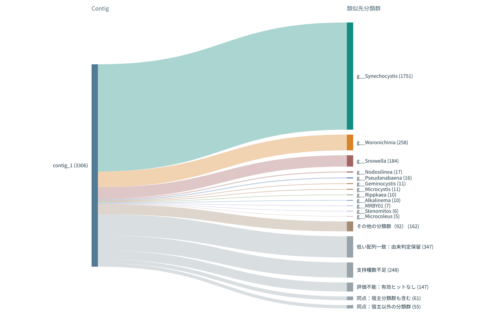
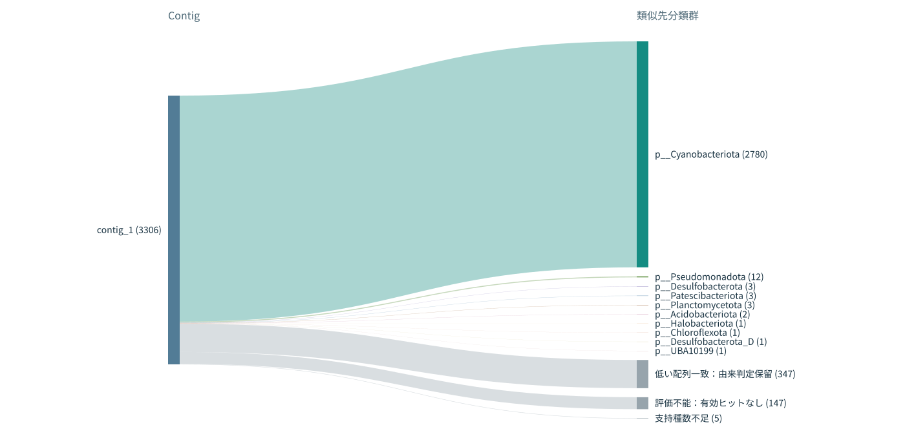
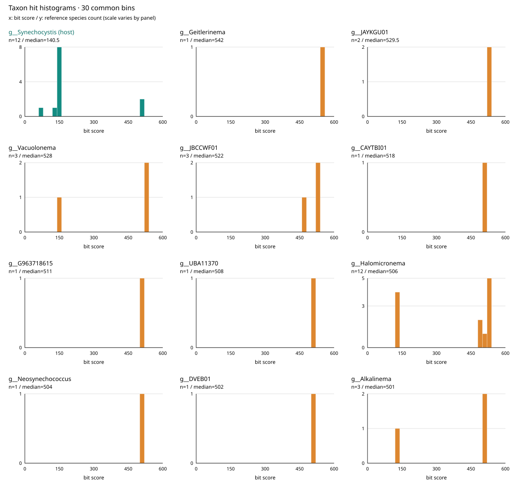

# HGT_Finder

**GTDBの分類とDIAMONDのタンパク質ヒットを使い、遺伝子と連続領域のHGT候補を探索するツールです。** ORFごとの類似性スコア、既定で5 ORFの移動平均、候補領域、オフラインで動くレポートとサンキープロットを出力します。現在は **0.1.3** です。

近縁の境界を門・綱・目・科・属から指定できます。サンキープロットは一つのHTML内で5階層をボタンで切り替え、contig・座標・候補領域で絞り込めます。

## サンキープロットの例

LKSZ1（`GCF_040436315.1`）の全3,306 ORFを、GTDB R232の全199,923代表ゲノム・618,638,921タンパク質へ検索した結果です。**以下の図は配列一致の品質下限0.5を分類表示に適用しています。**

### 属で表示



宿主属 *Synechocystis* への割り当て1,751 ORF、別属697、同点116、支持種数不足248、低品質で由来判定保留347、有効ヒットなし147です。

### 門で表示



宿主と同じCyanobacteriotaへの割り当て2,780 ORF、別門27、支持種数不足5、低品質347、有効ヒットなし147です。線の太さはORF数で、各ORFは1票です。

[操作できるHTML例と分類TSV](docs/examples/LKSZ1/)も同梱しています。リポジトリをダウンロードし、`docs/examples/LKSZ1/sankey.html`をブラウザーで開いてください。GitHubのファイル画面ではHTMLを実行しません。門・綱・目・科・属の切り替え、ORF一覧、座標の絞り込み、SVG保存を利用できます。公開例には生のDIAMONDヒットや全参照DBは含めていません。

**サンキーは最高ヒットの所属先を示す探索図です。HGTの確定判定、歴史的なドナー、転移方向、汚染率を示しません。** GUNCの判定値も計算していません。例の品質条件は分類表示に適用したもので、付属するORF/windowスコアと候補領域は2026-10-09の品質条件追加前の解析結果を保持しています。

## インストール

Python 3.10以上、Biopython、DIAMONDを使います。DIAMONDは別途インストールし、`diamond`をPATHに置いてください。

```sh
git clone https://github.com/kazumaxneo/HGT_Finder.git
cd HGT_Finder
python -m venv .venv
source .venv/bin/activate
python -m pip install -e .
HGT_Finder --help
HGT_Finder --version
```

CLI名は`HGT_Finder`です。既存のローカル利用との互換性のため`gtdb-hgt`も同じ機能を呼び出します。Pythonモジュール名は`gtdb_hgt`で、`python -m gtdb_hgt`でも実行できます。

## 最初の実行

対応するDIAMOND DBとGTDB分類表があれば、翻訳済みCDSを含むGenBankから一コマンドで検索・集計・レポート作成まで実行できます。

```sh
HGT_Finder run \
  --genbank /path/to/query.gbk \
  --db /path/to/gtdb_db/proteins.dmnd \
  --taxonomy /path/to/gtdb_db/taxonomy.tsv \
  --query-genome GCF_040436315.1 \
  --threads 32 \
  --sankey \
  --out runs/query_genus \
  --database-label 'GTDB R232 representatives'
```

`--query-genome`には実際のクエリゲノムのaccessionを指定します。分類表にないクエリは、代わりに`--query-taxonomy`へ7階層のGTDB lineageを渡します。

```text
d__Bacteria;p__Cyanobacteriota;c__Cyanobacteriia;o__Cyanobacteriales;f__Microcystaceae;g__Synechocystis;s__Synechocystis sp040436315
```

FAAを用意済みなら`--genbank`の代わりに`--query-faa query.faa --genes genes.tsv`を指定します。genes TSVの必須列は`orf_id`, `contig`, `start`, `end`です。座標は1-based、両端を含みます。`gene`, `product`, `strand`も指定できます。GenBankで翻訳のないCDSは`excluded_cds.tsv`へ記録します。

## 参照DBを作る

ゲノムごとのFAAディレクトリ、またはtarアーカイブとGTDB分類TSVを用意します。FAAファイル名に`GCA_`または`GCF_`のaccessionが必要です。

```sh
HGT_Finder build-db \
  --proteins /path/to/gtdb_proteins_aa_reps_r232.tar.gz \
  --taxonomy /path/to/gtdb_taxonomy.tsv \
  --out /path/to/gtdb_db \
  --threads 32 \
  --database-label 'GTDB R232 representatives'
```

タンパク質IDを`genome_accession::original_protein_id`に変換し、DBに実際に収録したゲノムの分類表を保存します。分類がないゲノムはスキップし、`database.json`に記録します。GTDB-Tkのマーカー参照データだけでは、全タンパク質blastp用DBを作れません。変換FAAとDIAMOND DBを保存するディスク容量も必要です。

既存DBのIDには`--subject-map`で`sseqid`と`genome_id`の対応TSVを指定できます。分類表がDBの収録範囲より広い場合は、`--reference-genomes`で実際の収録ゲノムに限定してください。`RS_`／`GB_`接頭辞は扱いますが、GCAとGCFを自動的に同一視しません。

## 既定の設定

| 項目 | 既定値 |
|---|---|
| 近縁群の境界 `--close-rank` | genus（同属） |
| 遠縁群の集計 `--donor-rank` | genus |
| 検索件数上限 `--max-target-seqs` | 0（件数上限なし） |
| DIAMOND感度 `--sensitivity` | very-sensitive |
| E-value `--evalue` | 1e-10 |
| query／subject coverage | 各0.5以上 |
| 品質下限 `--min-hit-quality` | 0.5以上 |
| 自己参照の除外 `--self-exclude-rank` | 同じGTDB種 |
| 近縁参照種数 `--min-close-species` | 3 |
| 遠縁群の支持種数 `--min-donor-species` | 2 |
| 移動平均 `--window` | 隣接5 ORF |
| 平均に必要な有効ORF `--min-valid` | 3 |
| windowを分ける遺伝子間距離 `--max-gap-bp` | 10,000 bp超 |
| 仮の領域閾値 `--threshold` | 0.15 |
| 候補の最小長 `--min-region-orfs` | 3 ORF |
| サンキーの僅差 `--sankey-margin` | 0.01（1%以下） |

検索件数上限なしでも、感度・マスキング・有意性条件・DIAMONDの探索の制約は残ります。

## ORFスコアと領域候補

1. 有意性・coverage・自己除外の条件を通過したヒットをGTDB種ごとにまとめ、各種の最良タンパク質ヒットを残します。
2. 近縁側は種別bit scoreの中央値、遠縁側は分類群ごとの種別中央値を計算します。必要な支持種数を満たす遠縁群のうち、最も高い中央値を採用します。
3. `(遠縁側の中央値 − 近縁側の中央値) / ORFの自己比較bit score`をORFスコアとします。
4. 品質・支持条件を満たすORFの移動平均を計算し、閾値以上が連続した部分を候補領域として出力します。

例：近縁3種が330・340・350、遠縁のある属の2種が430・450、自己比較が500なら、スコアは`(440−340)/500 = 0.20`です。遠縁の別属に490の単独ヒットがあっても、既定の2種支持を満たしません。

正の値は遠縁側との類似が優勢、負の値は近縁側が優勢という意味です。**スコアも閾値0.15も、校正済みのHGT確率ではありません。**

近縁ヒットがない場合は既定の`--missing-close zero`で、未検出を明記して近縁の観測値を0として扱います。これは生物学的な遺伝子の不在を意味しません。`--missing-close na`ならwindowから除外します。件数上限なしの検索が確認できない外部ヒットには、zero方針を自動でNAへ変更します。

NAやwindow対象外のORFは平均へ含めません。contig境界と大きな遺伝子間距離でwindowを分割します。短い端のwindowにはフラグを付けます。環状ゲノムの原点をまたぐwindowには未対応です。領域境界は選ばれたORFの範囲で、転移の切断点ではありません。

## 配列一致の品質スコア

[WAAFLEの実装](https://github.com/biobakery/waafle/blob/master/waafle/utils.py)と[遺伝子上の評価](https://github.com/biobakery/waafle/blob/master/waafle/waafle_orgscorer.py)を参考に、全長タンパク質ORFへの単一ヒットを次で評価します。

```text
品質 = (アミノ酸一致率 / 100) × query coverage × subject coverage
```

一致率60%、両coverage 98%なら0.57624。一致率33.1%、query 98%、subject 97%なら約0.31465。一致率90%でも両coverage 50%なら0.225です。

`--min-hit-quality 0.5`が既定値です。0.5以上を残し、0.5未満は由来判定を保留します。例えば`--min-hit-quality 0.6`へ変更でき、0なら品質による除外を無効にします。

比較ヒットを削除せず、bit scoreで順位・中央値を計算した後に品質を確認します。全体の最高bit-scoreヒットが下限未満ならORFスコアはNA、正のORFスコアでは選択した遠縁群の最良bit-scoreヒットにも同じ下限を要求します。弱い最高ヒットを別の分類群や宿主のヒットに置き換えません。

WAAFLE本来の塩基配列解析と異なり、contig端補正や複数HSPの位置別統合は行いません。タンパク質用閾値0.5の感度・特異度は未校正で、WAAFLEそのものの結果を再現するものではありません。品質・E-value・HGTの相対スコアは別の指標です。

## 再検索せず設定を変更する

保存した14列DIAMONDヒットから、近縁範囲やwindow、品質下限を変更できます。

```sh
HGT_Finder analyze \
  --hits runs/query_genus/hits.tsv.gz \
  --self-hits runs/query_genus/self_hits.tsv \
  --genes runs/query_genus/input/genes.tsv \
  --taxonomy /path/to/gtdb_db/taxonomy.tsv \
  --query-genome GCF_040436315.1 \
  --close-rank family --window 5 --min-hit-quality 0.5 \
  --sankey --out runs/query_family
```

ヒットの列順は次の通りです。

```text
qseqid sseqid pident length mismatch gapopen qstart qend sstart send evalue bitscore qlen slen
```

外部ヒットには、件数上限なしを確認した場合だけ`--assume-unlimited-hits`を指定します。出力フォルダーは毎回新しく作成し、既存結果を上書きしません。

### 分類表示だけを変更する

```sh
HGT_Finder sankey \
  --run-dir runs/query_genus \
  --min-hit-quality 0.5 \
  --out runs/query_sankey_0_5
```

**`sankey`は検索やHGTスコアの再計算をしません。** 品質下限を分類表示へ適用し、元のORF/windowスコア・候補領域を保持します。HGTのスコアや領域にも新しい品質条件を反映する場合は`analyze`を使います。

保存済み分類TSVの再利用は、方式・支持種数・僅差設定が同じ場合に行います。属別ヒット集計からの再生成には`--close-rank genus --donor-rank genus`で解析した結果が必要です。上位階層の中央値は属別集計から復元できないため空欄とします。保存集計による中央値方式は属のみで、通常の`run`／`analyze`では種別ヒットから各階層を評価します。

品質情報がない古い結果には、`--quality-audit /path/to/top_hit_quality.tsv`を渡します。`scripts/audit_all_top_hit_quality.py`が古いSQLiteと生ヒットから元の最高ヒットを回収します。監査の完了、元の分類TSVのハッシュ、ORFのID・座標、品質計算を照合します。品質情報のない結果をそのまま描く場合は`--min-hit-quality 0`を指定します。

## サンキープロットの操作と判定

`run`／`analyze`に`--sankey`を付けると、追加ライブラリーやCDNを使わない`sankey.html`を出力します。

- 左はcontig、右は最高ヒットの分類群、線の太さはORF数です。
- 門・綱・目・科・属を切り替えても、対象領域・contig・座標の条件を保ちます。
- 線をクリックするとORF一覧を絞れます。一致率、両coverage、品質スコアも確認できます。
- 宿主と同じ分類群は青緑、他分類群は別色、同点・支持不足・低品質・評価不能は灰色です。
- SVG保存と階層ごとのTSV出力を利用できます。

最高bit scoreが一意ならその所属先を表示します。別群と同点なら曖昧、最高群の全有効ヒットの種数が2未満なら支持種数不足とし、より弱い群で置き換えません。上位2群の相対差が1%以下でも、一意の最高値なら所属先を表示し`near_tie`を記録します。支持種数は最高値付近のヒットだけの数ではありません。

`--sankey-rank`は初期表示、`--sankey-max-contigs 20`／`--sankey-max-taxa 12`は集約数を指定します。小さな群を「その他」にまとめても票数は保存します。従来の中央値比較は`--sankey-method median --sankey-margin 0.05`で使えます。

LKSZ1のnif例はcontig_1の291,513–313,504 bp、27 ORFです。公開図でこの座標を指定できます。品質0.5以上25 ORF、低品質1、有効ヒットなし1です。属では13が別属へ割り当てられ、同点5、支持不足7で、宿主属への割り当ては0です。門では品質を満たす25 ORFが宿主と同じCyanobacteriotaにまとまります。同じ門への割り当てはHGTの否定を意味しません。

## ORFごとの分類群別ヒット分布（0.1.3追加）

各ORFについて、**横軸がbit score、縦軸がGTDB参照種数のヒストグラム**を、選択した分類群ごとに色分けして重ねます。各参照種の最良ヒットを1回ずつ数え、門・綱・目・科・属を切り替えられます。比較したい分類群をチェックリストから個別に選べます。全分類群・全階級で共通の区間幅と横軸範囲を使い、重ね描きでは縦軸も共通です。分類群ごとのパネル表示にも切り替えられ、その場合は縦軸の範囲がパネルごとに異なります。ビン数は画面で1–200に変更できます（初期値30）。区間は下端を含み上端を含まず、最終区間のみ上端も含みます。



nifH（`LKSZ1_00287`）には20,692参照種の有効ヒットがあります。宿主属Synechocystisは12種、中央値140.5 bit、最大500 bit。図で比較しているHalomicronemaは12種、中央値506 bitです。JAYKGU01は2種、中央値529.5 bitです。Geitlerinemaの542 bitは1種だけの支持なので、少数の強いヒットも区別して確認できます。

[操作できる分布の例](docs/examples/LKSZ1/hit_distributions/)にはnifH・nifK・nifDと比較用ORF、計5 ORF／33,388参照種を収録しています。ダウンロードして`index.html`を開いてください。公開サンキーとレポートの対象ORF IDからも開けます。古いSQLiteの例では一致率・E-valueが未保存なので、各ヒットの品質は未取得として表示し、推定で補いません。

### 保存済みの解析から生成する

```sh
HGT_Finder distribution \
  --run-dir runs/query_genus \
  --orf-id LKSZ1_00287 \
  --orf-id LKSZ1_00279 \
  --out runs/nif_hit_distributions
```

ORF IDを繰り返して選択できます。全ORFを生成する場合は`--orf-id`の代わりに`--all-orfs`を指定します。ORFごとの個別HTMLを出力し、検索もHGTスコア再計算も行いません。分布は中央値だけのTSVから復元できないため、解析時の`species_hits.sqlite`が必要です。

新しいSQLiteにはゲノム番号と分類の対応を保存するので、元の分類TSVを移動しても使えます。0.1.0以前のSQLiteには`--taxonomy /path/to/original/taxonomy.tsv`を渡せます。元の分類表とハッシュを照合します。古い非標準タンパク質IDには`--subject-map`も指定できます。元のDBは読み取り専用で開きます。

### run／analyzeと同時に生成する

サンキープロットとヒストグラムは独立した追加出力です。どちらか一方、または両方を選べます。ヒストグラムの追加後も、従来のサンキーの出力・分類階級切り替え・絞り込み・SVG保存を維持しています。

| 出したい図 | `run`／`analyze`に追加するオプション |
|---|---|
| サンキーのみ | `--sankey` |
| ヒストグラムのみ（選んだORF） | `--distribution-orf ORF_ID`（複数指定可） |
| 両方 | `--sankey --distribution-orf ORF_ID` |

全ORFのヒストグラムを出す場合は、`--distribution-orf ORF_ID`の代わりに`--hit-distributions`を使います。保存済みの解析に対しても、`sankey`と`distribution`を個別に実行できます。

`--distribution-orf ORF_ID`を付ければ、指定ORFの分布とレポート／サンキーからのリンクも作成します。複数指定できます。`--hit-distributions`のみを指定すると全ORFを生成します。出力容量はORF数と参照種数に応じて増えるため、必要なORFを選んで生成することもできます。

```sh
HGT_Finder run \
  --genbank /path/to/query.gbk \
  --db /path/to/gtdb_db/proteins.dmnd \
  --taxonomy /path/to/gtdb_db/taxonomy.tsv \
  --query-genome GCF_040436315.1 \
  --threads 32 --sankey \
  --distribution-orf LKSZ1_00287 \
  --out runs/query_with_distributions
```

初期表示は宿主群を含む12分類群で、他群は中央値の高い順です。チェックリストには全分類群があり、初期表示に含まれない群も検索して追加できます。例えば「属」→「宿主のみ」でSynechocystisを残し、Halomicronemaを検索してチェックすると、その2属のヒット分布だけを比較できます。宿主群も解除できます。選択内容は階級ごとに保持し、品質フィルターや表示形式を変えても保持します。自動選択する分類群数を変えた後は「上位Nを選択」を押してください。非表示の群数・参照種数も明示します。表示する分類群内の参照種を間引く処理は行わず、全分類群のデータはTSVにも保存します。

初期状態は品質が低いヒットも含む全有効ヒットの分布です。品質下限は0.5です。「品質下限以上のみ」にチェックすると、未取得も除外し、表示中のヒットから度数・中央値・支持数を再計算します。この絞り込みは図だけに作用し、元のHGTスコア・候補領域を変えません。選択した分類群のSVG保存、表示中の区間別度数TSV保存、全参照種・全5階層の集計TSV出力も利用できます。

## 出力

| ファイル | 内容 |
|---|---|
| `report.html` | 座標範囲を選べるスコアグラフ、ORF・候補領域一覧 |
| `orf_scores.tsv` | 全ORFのスコア、移動平均、品質、支持数、評価可否 |
| `regions.tsv` | window閾値以上が連続する候補領域 |
| `taxon_summaries.tsv` | ORF・分類群別の中央値と支持種数 |
| `run.json` | 設定、入力ハッシュ、検索条件、件数 |
| `species_hits.sqlite` | 種単位の集計用ディスクストア |
| `sankey.html` | 5階層を切り替えられるオフライン図（`--sankey`） |
| `sankey_orfs_<rank>.tsv` | 階層ごとの分類・支持・品質情報 |
| `contig_taxonomy_<rank>.tsv` | 階層ごとのcontig集計 |
| `hit_distributions/index.html` | 生成したORFの分布ページ一覧 |
| `hit_distributions/orf_*.html` | 分類群別ヒストグラム・支持数と5階層切り替え |
| `hit_distributions/orf_*_hits.tsv` | 各参照種の最良ヒットと品質指標 |
| `hit_distributions/orf_*_summary.tsv` | 全5階層の分布集計（品質で絞る前） |

生ヒットはgzip、種単位の集計はSQLiteに保存し、生ヒット全体をRAMへ載せません。`raw_orf_score`は品質条件適用前のスコアです。`top_hit_*`、`donor_top_hit_quality`、`quality_status`に根拠を記録します。

## フルGTDB R232での実測

LKSZ1全3,306 ORF、GTDB R232全199,923代表ゲノム・618,638,921タンパク質、DIAMOND 2.1.9、Threadripper 3990X、32スレッド、very-sensitive、E-value 1e-10、件数上限なし、外付けHDD上での1回の実測です。OSキャッシュは消去していません。

| 処理 | 実測時間 |
|---|---:|
| ORF抽出 | 0.257秒 |
| 全参照DB検索・ヒット出力 | 4時間28分59.428秒 |
| 自己比較 | 1.198秒 |
| ヒット集計・スコア計算・出力 | 4時間47分49.804秒 |
| Python起動を含むrun全体 | 9時間16分50.933秒 |

DB構築は別途2時間10分16.420秒です。生ヒット681,631,761件、最大プロセスRSS85.379 GiBでした。この値は同時に動く全プロセスの合計メモリではありません。

**上記は2026-10-09の品質条件追加前の実測です。** 品質下限0.5を加えた現行版のフル解析時間としては測り直していません。公開サンキー例は保存済み最高ヒットの品質監査と分類表示の更新によるものです。元の83候補領域とnifを含む33 ORFのcandidate_7は再計算していません。

実測スクリプトは`scripts/benchmark_run.py`です。DB構築を除き、Pythonの起動を含めたrun時間を測定します。

```sh
python scripts/benchmark_run.py --expected-genomes 199923 -- \
  --genbank /path/to/query.gbk \
  --db /path/to/full_db/proteins.dmnd \
  --taxonomy /path/to/full_db/taxonomy.tsv \
  --query-genome GCF_040436315.1 \
  --threads 32 --sankey --out runs/measured
```

## 検証と制限

```sh
python -m unittest discover -s tests -v
```

35件のPythonテストで、種単位の重複除去、SQLiteとメモリ集計の一致、近縁範囲、未検出、window境界、品質0.5の境界、監査照合、品質下限変更時の分類復元、種別点の復元、中央値、旧SQLite対応、レポートからのリンクを確認しています。公開HTMLはNodeで5階層の票数保存、分布集計とPythonの一致、生成されたクリックハンドラー、絞り込み、保存名、JavaScript構文を検証しています。実ブラウザーのレイアウトと操作は未検証です。

0.1.3は類似性に基づく候補探索版です。オルソロジー推定、遺伝子樹と種樹の照合、転移方向の推定、GUNCの汚染判定は実装していません。nifH類縁タンパク質やパラログなどは、注釈・遺伝子系統・周辺遺伝子を併せて評価してください。

参考：[GTDB R232代表ゲノム配布](https://data.gtdb.ecogenomic.org/releases/release232/232.0/genomic_files_reps/)、[DIAMOND公式コマンド説明](https://github.com/bbuchfink/diamond/wiki/3.-Command-line-options)、[WAAFLE](https://github.com/biobakery/waafle)。
